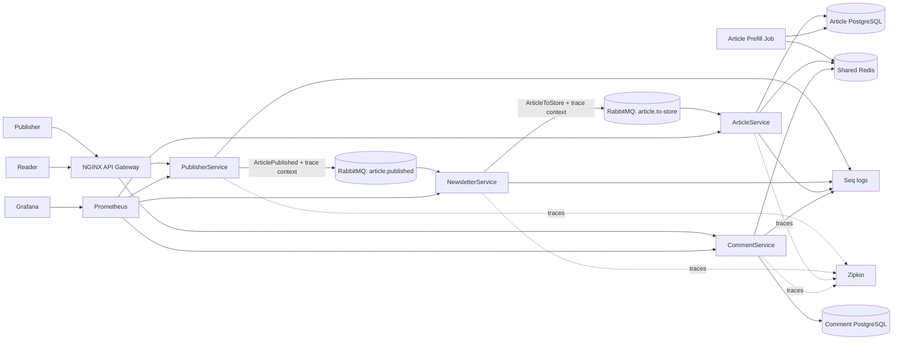

# Happy Headlines

Happy Headlines is a Development of Large Systems course project. It demonstrates containerized services, C4 architecture, the AKF Scale Cube, asynchronous messaging, fault isolation, observability, distributed tracing, and caching.

The project emphasizes how the system is structured and operated rather than building a feature-rich news product.

## Architecture at a glance



ArticleService and CommentService own separate PostgreSQL containers. Each database partitions its rows by `eu` and `na`; the gateway passes `X-Region` through to the owning service. Redis is one shared local instance with region-qualified keys. This demonstrates a logical regional Z-axis split locally, not physically regional caches, production multi-region hosting, or disaster recovery.

### Project layout

- `src/PublisherService/` — `Controllers/`, `Services/`, and RabbitMQ `Infrastructure/`.
- `src/NewsletterService/` — `Services/`, queue `Workers/`, RabbitMQ `Infrastructure/`, and `Configuration/`; no business HTTP controller.
- `src/ArticleService/` — `Controllers/`, `Services/`, PostgreSQL/Redis `Infrastructure/`, and the RabbitMQ `Workers/` consumer.
- `src/CommentService/` — `Controllers/`, `Services/`, and PostgreSQL/Redis `Infrastructure/`.
- `src/PrefillJob/` — scheduled `Workers/`, prefill `Services/`, and database/cache `Infrastructure/`; no HTTP controller.
- `src/Shared/` — shared contracts, configuration, logging, metrics, tracing, and locking helpers.
- `infra/` — PostgreSQL initialization, NGINX gateway, Prometheus configuration, and provisioned Grafana dashboard.
- `docs/architecture/` — Structurizr C4 model, workflow, design decisions, and course principle notes.
- `docs/presentations/week40-cache-presentation.md` — presentation walkthrough and speaker notes.

Each `Program.cs` is the composition root: it configures the host, registers dependencies, adds middleware, maps controllers where present, and starts the application. Health and metrics remain infrastructure endpoints.

## Requirements

- .NET 10 SDK
- Docker Engine and Docker Compose v2
- `curl`, `python3`, and Bash for the smoke test
- k6 is optional; it runs in its own Compose profile, so it does not need to be installed on the host

## Build and start

Run these commands from the project root. The .NET 10 SDK publishes the application artifacts first; Compose builds runtime images from them:

```bash
./scripts/build.sh
docker compose up --build -d --wait
```

The build script publishes the five .NET applications into `artifacts/`. Docker then copies those publish outputs into lean .NET runtime images. Run the build script again after changing application code before rebuilding the Compose images.

Check that the services are running:

```bash
docker compose ps
```

## Local URLs and ports

| Service | URL / host port | Purpose |
|---|---|---|
| API gateway | <http://localhost:8080> | Application API entry point |
| Structurizr Lite | <http://localhost:8081> | Render C4 views from `docs/architecture/workspace.dsl` |
| Grafana | <http://localhost:3000> | Dashboard; `admin` / `happy-headlines` |
| Prometheus | <http://localhost:9090> | Metrics and PromQL |
| Seq | <http://localhost:8083> | Structured logs; ingestion port 5341 |
| Zipkin | <http://localhost:9411> | Distributed traces |
| RabbitMQ management | <http://localhost:15672> | Queue inspection; `guest` / `guest` |
| RabbitMQ AMQP | `localhost:5672` | Application messaging |
| Redis | `localhost:6379` | Shared cache |
| Article PostgreSQL | `localhost:55432` | Article data; `happy` / `happy` |
| Comment PostgreSQL | `localhost:55433` | Comment data; `happy` / `happy` |

The ASP.NET services are exposed to the Compose network and accessed from the host through the gateway. The additional database/cache/broker ports are for local development and inspection.

## Try the API

Publish an article. The `202 Accepted` response means the request was queued; the article is stored asynchronously by ArticleService.

```bash
response="$(curl -fsS -X POST http://localhost:8080/publish \
  -H 'Content-Type: application/json' \
  -d '{"title":"Example headline","body":"An example article body.","region":"eu"}')"
printf '%s\n' "$response"
article_id="$(python3 -c 'import json,sys; print(json.load(sys.stdin)["id"])' <<<"$response")"
```

PublisherService returns `202 Accepted` with the article ID because processing continues asynchronously. The following bounded loop waits for the queue consumers to persist it, then both reads use the same region. Run these snippets in the same terminal so `$article_id` remains set:

```bash
for _ in $(seq 1 30); do
  if curl -fsS "http://localhost:8080/articles/$article_id" -H 'X-Region: eu' >/dev/null; then break; fi
  sleep 1
done
curl -i "http://localhost:8080/articles/$article_id" -H 'X-Region: eu'
curl -i 'http://localhost:8080/articles?region=eu'
```

Add and read comments:

```bash
curl -i -X POST "http://localhost:8080/articles/$article_id/comments" \
  -H 'X-Region: eu' -H 'Content-Type: application/json' \
  -d '{"body":"A reader comment."}'

curl -i "http://localhost:8080/articles/$article_id/comments" -H 'X-Region: eu'
```

The `X-Region` header selects the logical regional partition. The implementation accepts `eu` and `na`; unknown values default to `na`.

## Week 40 cache demonstration

- **Articles:** the single Article Prefill Job loads articles published in the last 14 days every 6 hours, with an 8-hour Redis TTL. Article reads use cache-aside on a miss.
- **Comments:** reads use cache-aside, comment writes invalidate that article’s comment list, and Redis maintains the 30 most recently used article IDs per region. The 30-item bound is exact; Redis `allkeys-lru` also limits memory but is not used as the exact-count mechanism.
- **Cache failure:** if Redis is unavailable, reads fall back to the owning PostgreSQL service. Set `Caching__ArticleEnabled=false` or `Caching__CommentEnabled=false` to bypass a cache without changing API behavior.
- **Cache stampede:** concurrent misses are coalesced within each service process, and the shared Redis cache prevents independent per-instance caches.

Useful local inspection commands:

```bash
docker compose exec redis redis-cli PING
docker compose exec redis redis-cli CONFIG GET maxmemory-policy
docker compose exec redis redis-cli --scan --pattern 'article:eu:*'
docker compose exec redis redis-cli TTL 'article:eu:paste-article-id-here'
docker compose exec redis redis-cli ZCARD 'comments:lru:eu:30'
```

In Grafana, open **Happy Headlines — Cache and Service Health**. It separates hit ratio and hit/miss rates by cache layer and region, and includes request volume, p95 latencies, errors, cache fallbacks, and cache-bypass metrics. Zipkin shows the publication trace across PublisherService, NewsletterService, and ArticleService.

## Build, smoke test, and scale out

The solution build verifies compilation. The smoke test requires the Compose stack to be running and checks queued publication, persistence, region isolation, cache hits, comment invalidation, and the comment-list LRU bound:

```bash
dotnet build HappyHeadlines.slnx
./scripts/smoke-test.sh
```

To demonstrate X-axis scaling and run the included 10-VU, 30-second k6 test:

```bash
./scripts/build.sh
docker compose up --build -d --wait --scale article-service=2
docker compose --profile loadtest run --rm --no-deps k6
```

That command exercises the article-list route. To also load one particular article and its comments, supply an existing article ID. Keep the ID in a shell variable so it is passed safely:

```bash
export ARTICLE_ID='actual-article-guid'
docker compose --profile loadtest run --rm --no-deps -e ARTICLE_ID k6
```

`--no-deps` keeps the chosen replica count unchanged; the stack must already be running. The k6 thresholds are local teaching targets, not production capacity claims.

## Stop or reset

Stop the stack while keeping persisted database and monitoring volumes:

```bash
docker compose down
```

To reset the local databases, Redis, and monitoring state as well:

```bash
docker compose down -v
./scripts/build.sh
docker compose up --build -d --wait
```

## Course mapping and Week 40 presentation

- Week 35: Docker/Compose and C4 context, container, and component views.
- Week 36: headroom analysis plus X-axis replication and Z-axis regional partitioning.
- Week 37: asynchronous design, service isolation, cache bypass, and scale-out.
- Week 38: design-to-be-monitored, structured logs, metrics, and C4 monitoring components.
- Week 39: RabbitMQ workflow, trace propagation, and service observability.
- Week 40: Redis prefill/read-on-miss, TTL/LRU decisions, Prometheus metrics, and Grafana dashboard.
- Week 41: organisational analysis informs service ownership; it is not an application feature.

The Week 40 notes specify a live Zoom presentation and no compulsory file hand-in; confirm your presentation slot in Moodle. Speaker notes and a demonstration plan are in [`docs/presentations/week40-cache-presentation.md`](docs/presentations/week40-cache-presentation.md).
